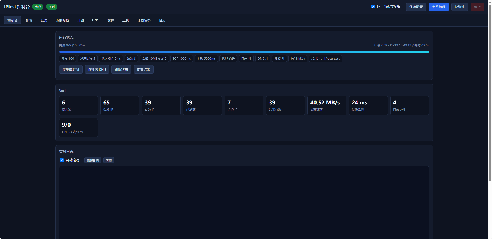

# iptest

> Cloudflare 优选 IP 测速 / 订阅生成 / DNS 推送 / 历史归档 / 计划任务。内置 **Web 控制台**（默认 `:3000`），保留纯 CLI 模式，零第三方依赖。

[](https://www.gnu.org/licenses/gpl-3.0)
[](https://github.com/lgs3137/iptest/actions/workflows/Releases.yaml)

## Web页面示例



## 特性

- **测速**：TCP 延迟 → 真连接探测（国家 / 数据中心 / ASN / 出口 IP）→ 并发下载测速（MB/s）
- **多源采集**：本地路径 / `file://` / `http(s)://` 混合输入，明文与 Base64 订阅自动解析，递归发现新源并去重
- **排序策略**：先按延迟升序再测速；`speedtest=0` 时按 `rounds` 轮延迟均值排序
- **提前停止**：`min_speed` + `min_speed_count` 命中即停，省时省流量
- **订阅生成**：`ip` / `domain` 双类型，单模板通用，可选 Base64
- **DNS 推送**：自动判断 A / AAAA，存在即更新；另支持**手动填写单条记录**推送
- **历史归档**：每次追加前 N 名，按行数上限自动裁剪，可直接复用为输入源
- **计划任务**：crontab 定时 + 两种前置条件（榜首掉速才跑 / 源有新增才跑）+ 定时 Shell 脚本
- **Web 控制台**：全参数可视化编辑、任务启停、阶段进度、实时日志（SSE）、结果 / 历史 / 订阅 / DNS / 文件 / 工具 / 计划任务全操作
- **路由伪装**：可设 URL 前缀，非前缀与不存在的路径一律返回 `200 Are you ok?`
- **代理**：仅远程源下载与 DNS 推送走代理，测速恒直连
- **配置优先**：命令行 > `config.json` > 内置默认；配置缺失自动生成，每次保存自动备份 `.bak`

## 快速开始

```bash
go build -trimpath -ldflags "-s -w" -o iptest .

./iptest                     # Web 控制台 → http://127.0.0.1:3000/
./iptest -prefix /iptest     # 带路径前缀 → http://127.0.0.1:3000/iptest/
./iptest -cli -file "ip.txt,https://sub.example.com/list.txt"   # 纯命令行跑一次
```

首次运行自动生成 `config.json`。默认产物：结果 `html/result.csv`、归档 `html/bestip.csv`、订阅 `html/*.txt`。

推荐流程：**配置**页填输入源 → 保存 → **工具**页解析预览确认能提取到 IP → **控制台**点「完整流程」→ 看进度与实时日志 → **结果**页排序查看 → 按需开启订阅 / DNS / 计划任务。

## 项目结构

```
.
├── go.mod
├── iptest.go        # 配置 / 参数 / 测速引擎 / 多源采集 / 历史归档
├── subscription.go  # 订阅构建与生成（支持预览）
├── dns.go           # Cloudflare DNS 计划 / 推送 / 查询 / 删除 / 单条 upsert
├── web.go           # 日志总线 + 任务状态机 + 计划任务 + HTTP API + 内嵌前端
├── config.json      # 首次运行自动生成
└── html/            # 结果 / 归档 / 订阅输出目录
```

## 运行模式

| 场景 | 命令 |
|---|---|
| Web 控制台（默认） | `./iptest` |
| 命令行跑一次完整流程 | `./iptest -cli` |
| 只生成订阅 / 只推 DNS | `./iptest -sub` / `./iptest -dns` |
| 临时关闭 Web | `./iptest -web=false` |
| 换端口 / 只本机监听 / 加前缀 | `./iptest -port 8080 -host 127.0.0.1 -prefix /iptest` |
| 指定配置文件 | `./iptest -config /etc/iptest/config.json` 或 `CFIP_CONFIG=...` |

`-cli` / `-sub` / `-dns` 强制走命令行；两种模式共用同一套引擎与配置，Ctrl+C 均可优雅停止。**计划任务只在 Web 模式下调度。**

## 命令行参数

| 参数 | 默认 | 说明 |
|---|---|---|
| `-file` | "" | 输入源列表（逗号分隔），覆盖配置 `file` |
| `-outfile` | html/result.csv | 结果输出文件 |
| `-max` | 100 | TCP / probe / 延迟阶段并发 |
| `-speedtest` | 5 | 下载测速协程数，`0` 禁用测速 |
| `-url` | speed.cloudflare.com/__down?bytes=20000000 | 测速地址（可省略协议头） |
| `-delay` | 0 | 延迟阈值 ms，`0` 不过滤 |
| `-rounds` | 3 | 延迟轮数，仅 `speedtest=0` 生效 |
| `-minspeed` / `-minspeedcount` | 0 / 0 | 合格速度（MB/s）与数量，同时 >0 时提前停止 |
| `-historyenable` / `-history` | false / "" | 归档开关与文件（配置默认 `true`） |
| `-historycount` / `-historylimit` | 3 / 1000 | 每次归档条数 / 行数上限（`0` 不限） |
| `-depth` | 2 | 输入源递归抓取深度 |
| `-proxy` | "" | 代理地址，仅远程下载与 DNS 推送 |
| `-sub` / `-dns` / `-cli` | false | 仅订阅 / 仅 DNS / 强制命令行 |
| `-web` / `-host` / `-port` / `-prefix` | — | Web 开关、监听与路径前缀 |
| `-config` | "" | 配置文件路径 |

## 配置文件

查找顺序：`-config` → 环境变量 `CFIP_CONFIG` → 当前目录 → 可执行文件目录；均不存在时自动生成（`go run` 时落在当前目录）。

```jsonc
{
  "file": ["html/bestip.csv"],        // 本地路径 / file:// / http(s):// 可混用
  "outfile": "html/result.csv",
  "proxy": "",                        // socks5://127.0.0.1:10808 或 http://...
  "max": 100,
  "speedtest": 5,                     // 0 = 只测延迟
  "url": "speed.cloudflare.com/__down?bytes=20000000",
  "delay": 0,
  "min_speed": 0,                     // 单位 MB/s，支持小数
  "min_speed_count": 0,
  "rounds": 3,
  "history_enable": true,
  "history": "html/bestip.csv",
  "history_count": 3,
  "history_limit": 1000,              // 0 = 不限制（不推荐）
  "tcp_timeout_ms": 1000,             // TCP 拨号超时
  "probe_timeout_ms": 3000,           // 真连接探测超时
  "download_timeout_ms": 5000,        // 单 IP 下载超时
  "source_timeout_ms": 20000,         // 远程输入源下载超时
  "source_depth": 2,                  // 源中发现 URL 的递归深度
  "probe_url": "https://probe.609909.xyz/",  // SNI 自动取该地址域名
  "sub_config": {
    "enabled": false,
    "output_dir": "html/",            // 文件页仅允许浏览/下载此目录
    "count": 15,                      // IP 节点数量上限，0 = 全部
    "node_name_tpl": "{index}{Country}{CountryCode}{ip}",
    "b64encode": true,
    "subtype": ["ip", "domain"],
    "preferred_domains": ["1.example.com", "2.example.com"],
    "templates": [
      {
        "ip_file_name": "subip.txt",
        "domain_file_name": "subdomain.txt",
        "template": "vless://AreYouOK@{ip}{domain}:{port}?encryption=none&security=tls&sni=your.domain.com&fp=chrome&type=xhttp&host=your.domain.com&path=/AreYouOK&mode=auto#{node_name_tpl}"
      }
    ]
  },
  "dns_config": {
    "enabled": false,
    "token": "",                      // Cloudflare API Token
    "zone_id": "",
    "domain_tpl": "{index}.example.com",
    "count": 9,                       // 0 = 全部
    "ttl": 300,                       // 1 = 自动；0/负数按 300 处理
    "proxied": false                  // 优选 IP 建议灰云
  },
  "web_config": {
    "enabled": true,                  // 以下 5 项变更需重启生效
    "host": "0.0.0.0",
    "port": 3000,
    "path_prefix": "",                // 例 /iptest，页面与接口全部挂在该前缀下
    "auto_run": false,                // 启动即自动跑完整流程
    "log_buffer": 5000,               // 以下 3 项保存即生效
    "username": "admin",
    "password": ""                    // 留空 = 不鉴权
  },
  "schedule": {                       // 计划任务，由「计划任务」页专用接口维护
    "enabled": false,
    "tasks": [
      {
        "id": "task-1",
        "name": "每日全流程(源有新增才跑)",
        "enabled": false,
        "cron": "0 4 * * *",
        "mode": "full",               // full/speedtest/sub/dns/script
        "timeout_sec": 0,             // 测速类 0 = 不限
        "guard": {
          "top_speed_enabled": true,  // 条件①：榜首复测
          "top_speed_mbps": 5,
          "top_ip": "",               // 留空 = 取结果第一名
          "top_port": 0,              // 0 = 用结果中的端口
          "source_changed_enabled": true  // 条件②：源有新增才跑
        }
      },
      {
        "id": "task-2",
        "name": "示例脚本(每日05:00)",
        "enabled": false,
        "cron": "0 5 * * *",
        "mode": "script",
        "shell": "",                  // 留空：Linux sh / Windows cmd
        "script": "echo \"hello\"\ndate\n",
        "timeout_sec": 120
      }
    ]
  }
}
```

所有相对路径以工作目录为基准，写出时父目录自动创建。

## Web 控制台

| 页签 | 能力 |
|---|---|
| 控制台 | 阶段进度、统计卡片、实时日志、四种任务启停 |
| 配置 | 全参数表单编辑、未保存变更提示、从磁盘重新载入、恢复默认 |
| 结果 | CSV 表格排序 / 搜索 / 分页 / 下载 |
| 历史归档 | 按批次分段展示、按上限清理、清空、下载 |
| 订阅 | 节点预览、生成文件、复制内容、订阅链接 |
| DNS | 推送计划预览、执行推送、记录查询与删除、**手动单条推送** |
| 文件 | 仅订阅输出目录的查看 / 下载 / Base64 解码 |
| 工具 | 输入源解析预览、代理测试（默认应用）、单 IP 探测 + 测速 |
| 计划任务 | cron 编辑与预览、前置条件、脚本、启停、立即执行 / 仅预检 |
| 日志 | 全量日志、级别与关键字过滤、debug 开关、导出 |

**鉴权**：`password` 非空即启用 Basic Auth（用户名默认 `iptest`）。

**路径前缀与伪装**：设置 `path_prefix=/iptest` 后，页面 `/iptest`（或 `/iptest/`）、接口 `/iptest/api/*`、订阅 `/iptest/sub/xxx.txt`；**其余任何路径（含根路径 `/`、错误前缀、不存在的页面/接口/订阅文件）一律返回 `200` + 纯文本 `Are you ok?`，不跳转、不返回 404/403**，避免被探测识别。真实接口自身的业务错误（参数错 / 未授权 / 任务冲突）仍返回 JSON，便于前端提示。

```nginx
location ~ ^/iptest/ {
    proxy_pass http://127.0.0.1:3000;
    proxy_http_version 1.1;
    proxy_set_header Host $host;
    proxy_set_header Connection "";
    proxy_buffering off;        # SSE 实时日志必须关闭缓冲
    proxy_read_timeout 3600s;
}
```

## 计划任务

调度器随 Web 服务运行，**Web 不常驻则不执行**（此时请用系统 crontab 调 `./iptest -cli`）。

### cron 语法

```
分(0-59) 时(0-23) 日(1-31) 月(1-12) 周(0-6, 0=周日, 7 也算周日)
支持 *  ,  -  /   ；月/周可用英文缩写 jan..dec / sun..sat
宏: @hourly @daily @weekly @monthly @yearly  @every 30m (最小 10s)
日与周同时限定时取“或”(标准 Vixie cron 语义)
```

| 需求 | 配置 |
|---|---|
| 每天 04:00 全流程 | `0 4 * * *` + 内容=完整流程 |
| 每 6 小时，榜首掉速才跑 | `0 */6 * * *` + 条件① 阈值 5 MB/s |
| 每 30 分钟，源有新增才跑 | `@every 30m` + 条件② |
| 工作日 03:30 跑脚本 | `30 3 * * 1-5` + 内容=Shell 脚本 |

### 前置条件（命中则跳过本次执行）

| 条件 | 逻辑 |
|---|---|
| ① 榜首 IP 复测 | 取上次结果第一名（或指定 IP）单独测速一次，**速度 ≥ 阈值 → 跳过**；无历史结果或测速失败视为需要执行 |
| ② 输入源有新增 | 先预采集一遍输入源，与上次快照比对，**本次 IP 全部命中旧记录（忽略顺序）→ 跳过** |

快照存于内存 + `os.TempDir()/iptest-source-snapshot.json`，每次采集自动刷新（内容未变不重复写盘），可在页面上查看与清空。条件②会额外采集一次源，源特别大时建议只开条件①。

### 定时脚本

- 脚本落成**临时文件**执行（`.bat` / `.ps1` / `.sh`），执行完自动删除，避免命令行引号转义污染输出
- Shell 留空：Linux/macOS 用 `sh`，Windows 用 `cmd`；可填 `bash` / `powershell` 等
- Windows `.bat` 自动加 `@echo off`（**只记录真实输出，不回显命令**），含中文时切 UTF-8 代码页，并恢复工作目录；PowerShell 写 UTF-8 BOM 的 `.ps1`
- stdout / stderr **逐行流式**写入日志中心，记录退出码与耗时
- 可用环境变量：`IPTEST_CONFIG` / `IPTEST_OUTFILE` / `IPTEST_SUBDIR` / `IPTEST_BIN` / `IPTEST_TASK`
- 超时默认 300 秒（可配），超时终止父进程

### 行为约定

- 编辑后需点「**保存计划**」写入配置；保存即**全量重建调度**并在日志打印每个任务的下次执行时间
- 已有任务运行中 → 本次触发跳过并记日志；同一任务不重叠；错过的那次不补偿
- 列表「启用」为勾选框，勾选后同样需要保存；开启调度后每 15s 只刷新启用任务的「下次执行 / 上次 / 状态」
- 测速类任务 `timeout_sec>0` 时超时会请求停止；`0` 表示不限
- 所有执行日志只进日志中心（内存 + stdout + SSE），**不写磁盘**

## 订阅生成

- `subtype` 为空时：有 `preferred_domains` → `["ip","domain"]`，否则 `["ip"]`
- `count` 只限制 IP 节点；域名节点数量等于 `preferred_domains` 长度
- 每个模板可同时产出一个 IP 文件与一个域名文件，留空则不生成

| 模板变量 | 说明 |
|---|---|
| `{ip}` | 测速 IP（生成域名订阅时为空） |
| `{domain}` | 优选域名（生成 IP 订阅时为空） |
| `{port}` | 端口 |
| `{node_name_tpl}` | 节点名，由 `node_name_tpl` 渲染 |

`node_name_tpl` 支持 `{index}` `{ip}` `{port}` `{country}` `{countrycode}` `{domain}`（大小写不敏感）。域名节点默认以域名本身命名，除非模板中显式使用 `{domain}`。

输出：`b64encode=false` 每行一个节点；`true` 整段 Base64。

## DNS 推送

1. Cloudflare → My Profile → API Tokens → Create Token，模板 **Edit zone DNS**（`Zone.DNS:Edit`，指定域名）
2. 域名 Overview → API 处复制 **Zone ID**
3. 填入 `token` / `zone_id`

**自动推送**：读取结果前 `count` 个 IP，`domain_tpl` 支持 `{index}` `{ip}` `{country}` `{countrycode}` `{port}`；自动判断 A / AAAA，先按「域名 + 类型」查询，存在 `PUT` 更新、不存在 `POST` 新建。

**手动单条**：DNS 页可直接填写 `type / name / content / ttl / proxied`（MX/SRV 可填 `priority`）提交；非 A/AAAA/CNAME 会自动关闭 proxied。计划任务脚本也可调用该接口推送特殊解析：

```bash
curl -s -u admin:密码 -X POST "http://127.0.0.1:3000/iptest/api/dns/record" \
  -H "Content-Type: application/json" \
  -d '{"type":"A","name":"a.example.com","content":"1.2.3.4","ttl":300,"proxied":false}'
```

## 历史归档

- 格式：每段一行 `# 时间` 注释 + 与 `result.csv` 相同的 9 列数据（无表头，延迟为整数毫秒）
- 裁剪：超过 `history_limit` 时从最早段删起，段内删空则连同注释行一并删除
- 复用：把归档路径加入 `file` 即可，`#` 注释行解析时自动忽略

## 代理边界

| 请求 | 走代理 |
|---|---|
| 远程输入源下载、DNS 推送、代理测试 | ✅ |
| 本地文件读取 | ❌ |
| probe 探测、下载测速（目标是待测 IP） | ❌ |

支持 `socks5://` `socks5h://` `http://` `https://`。启动时先验证代理，失败或非 200 自动回退直连。

## 输出结果

`result.csv` 固定 9 列：

```
IP地址,端口号,网络延迟ms,下载速度,国家,国家代码,数据中心,出站IP,ASN组织
104.16.1.1,443,42,12.34 MB/s,美国,US,LAX,104.16.1.1,"Cloudflare, Inc."
```

`speedtest=0` 时「下载速度」列为空，延迟为 `rounds` 轮均值并按延迟升序排序；否则按下载速度降序排序。

## API 一览

均位于 `path_prefix` 之下，返回 JSON。

| 方法 | 路径 | 说明 |
|---|---|---|
| GET | `/api/state` | 任务 / 进度 / 统计 / 代理 / 生效的 Web 参数 |
| GET · POST | `/api/config` | 读取（`?reload=1` 从磁盘重读）/ 保存 |
| POST | `/api/config/reset` | 恢复默认（旧配置备份 `.bak`） |
| POST | `/api/run` · `/api/stop` | 启动 `full·speedtest·sub·dns` / 取消 |
| GET · DELETE | `/api/logs` | 增量拉取 / 清空 |
| GET | `/api/events` | SSE：log / progress / state |
| GET | `/api/results` | 结果表（`file` `limit` `download=1`） |
| GET · POST | `/api/history` `/api/history/trim` `/clear` | 归档查看 / 清理 / 清空 |
| GET | `/api/files` · `/api/file` | 订阅目录列表 / 查看下载 |
| POST | `/api/sources/preview` `/api/proxy/test` `/api/ip/test` | 工具类 |
| POST | `/api/sub/preview` · `/api/sub/generate` | 订阅预览 / 生成 |
| POST · GET · DELETE | `/api/dns/plan` `/api/dns/records` | 计划 / 记录查询 / 删除 |
| POST | `/api/dns/record` | 手动推送/更新单条记录 |
| GET · POST | `/api/schedule` | 计划读取 / 保存（保存即重建调度） |
| POST | `/api/schedule/run` · `/api/schedule/preview` | 立即执行（`guard_only` / `ignore_guard`）/ cron 预览 |
| GET · DELETE | `/api/schedule/snapshot` | 输入源快照查看 / 清空 |
| GET | `/sub/{文件名}` | 订阅文件直链 |

## 构建

需要 Go 1.21+。

```bash
CGO_ENABLED=0 go build -trimpath -ldflags "-s -w" -o iptest .
CGO_ENABLED=0 GOOS=windows GOARCH=amd64 go build -trimpath -ldflags "-s -w" -o iptest.exe .
CGO_ENABLED=0 GOOS=linux  GOARCH=arm64 go build -trimpath -ldflags "-s -w" -o iptest-linux-arm64 .
```

## FAQ 与注意事项

- **配置文件在哪？** 见上文查找顺序；移动二进制时请一并移动 `config.json`，或用 `-config` 指定。
- **`min_speed` 单位？** MB/s，`2` 即 2 MB/s，支持 `1.5`。
- **`speedtest=0` 为什么还要等？** 会对每个可用 IP 额外做 `rounds` 轮 TCP 延迟取均值，调小 `rounds` 可加速。
- **归档会无限增长吗？** 默认上限 1000 行自动裁剪；设 `0` 关闭限制不推荐。
- **DNS 报 403？** 检查 Token 的 `Zone.DNS:Edit` 权限、`zone_id` 与域名是否一致，建议用 API Token 而非 Global Key。
- **Linux 提示文件描述符偏低？** 启动前执行 `ulimit -n 10000`（或改 `/etc/security/limits.conf`）；Windows 无需处理。
- **反代后只看到 `Are you ok?` / 日志不实时？** 前缀没对上——`proxy_pass` 两端都要保留前缀，且必须 `proxy_buffering off`。
- **计划任务没触发？** 确认 Web 服务在运行、总开关与任务都已启用且**已点保存**；日志会打印重新初始化后的下次执行时间。
- **Windows 脚本输出异常？** 默认 `cmd`（`.bat`）；需要 PowerShell 语法请把 Shell 填 `powershell`。脚本工作目录始终是程序运行目录。
- **安全**：`config.json` 含 CF Token，公网暴露务必设置 `web_config.password`，或只监听 `127.0.0.1` 再套反代。
- **任务互斥**：同一时刻只允许一个测速任务，冲突返回 409；停止任务时已完成部分仍会写入结果文件。
- **日志噪音**：逐 IP 探测失败记为 `debug`，前端默认隐藏，可在日志页开启。
- **路径含逗号**：`-file` 用逗号分隔，此类路径请写 `file:///data/a%2Cb.txt`。
- macOS 未签名二进制：`xattr -d com.apple.quarantine ./iptest`；UPX 压缩的 Windows 包可能被杀软误报。
- 请在法律允许范围内使用，禁止用于未授权的网络扫描或攻击。

## 致谢

- [Kwisma/iptest](https://github.com/Kwisma/iptest)
- [PoemMisty/CFData-WEB](https://github.com/PoemMisty/CFData-WEB)

## License

Copyright (C) 2026 PoemMisty — GNU GPL v3.0 or later，详见 `LICENSE`。